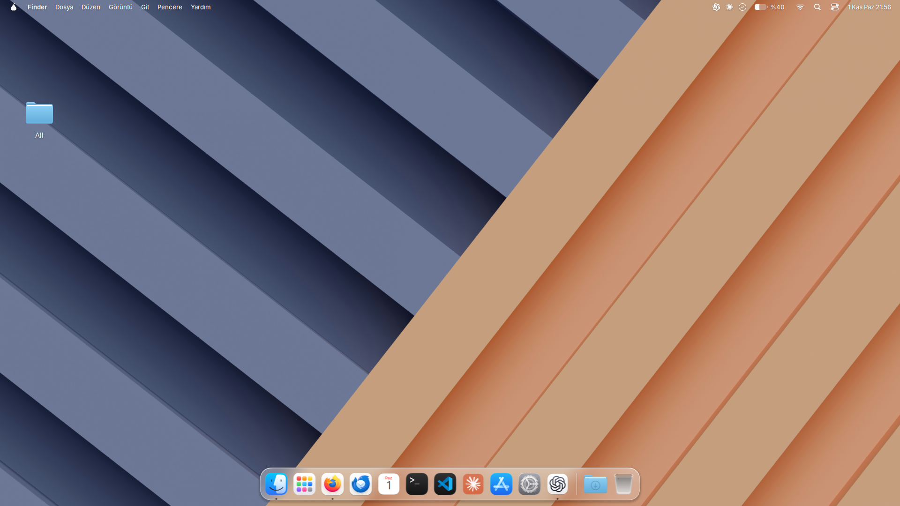

# Pear — kurulum ve kullanım kılavuzu

Pear, **Linux Mint Xfce'nin X11 oturumunda** çalışan, macOS'tan esinlenen bir
masaüstü arayüzüdür. Menü çubuğu, cam dock, widget'lar, uygulama ekranı, arama,
Bildirim Merkezi ve Control Center ekler. Python 3, GTK 3 ve cairo ile yazılmıştır.
Bir işletim sistemi veya pencere yöneticisi değildir.

Mint'in `mintreport` uygulaması kuruluysa Sistem Raporları'na Kontrol Merkezi'nden
erişebilirsin. Bluetooth ve Sistem Raporları simgeleri menü çubuğunda gösterilmez.



*Linux Mint Xfce üzerinde çalışan Pear'in menü çubuğu ve cam dock'u. Görseli tam boyutta açmak için üzerine tıklayabilirsin.*

**Durum: alfa/test sürümü.** Temiz sistemde grafik kurulum testleri hâlâ gereklidir.
[English README](../README.md).

## 1. Kurmadan önce sistemini kontrol et

Geliştirme ortamı **Linux Mint 22.3 Xfce + X11**. Başka bilgisayarda ilk deneme için
sanal makine veya ayrı bir test kullanıcısı tercih edebilirsin.

| Sistem | Durum |
| --- | --- |
| Linux Mint Xfce + X11 | Hedef ortam; temiz sistemde grafik kurulum doğrulaması henüz tamamlanmadı. |
| Diğer Debian/Ubuntu tabanlı XFCE + X11 sistemler | Deneysel; bağımlılıkların bulunması ve çalışma durumu doğrulanmadı. |
| Cinnamon, GNOME, KDE veya Wayland oturumları | Desteklenmiyor. `.deb` dosyasının kurulması bu oturumları uyumlu yapmaz. |
| Fedora ve Arch | Hazır paket ve kurulum yöntemi sağlanmıyor. |

**Kendi XFCE masaüstünde** terminal aç ve çalıştır:

```bash
printf 'Masaüstü: %s\nOturum: %s\nEkran: %s\n' \
  "$XDG_CURRENT_DESKTOP" "$XDG_SESSION_TYPE" "$DISPLAY"
```

Masaüstü değerinde `XFCE` bulunmalı, oturum `x11` olmalı ve ekran değeri boş
olmamalı; örneğin `:0`. Başka bir masaüstü veya Wayland kullanıyorsan oturumu
kapatıp XFCE/X11 oturumunu seç. Masaüstünü etkinleştirme işlemini SSH bağlantısından,
salt metin konsolundan veya root hesabından yapma.

İnternet bağlantısı ve sudo yetkisi gerekir. Python/GTK ve diğer bağımlılıklar apt
paketleriyle kurulur; pip veya Python sanal ortamı hazırlaman gerekmez. İlk
etkinleştirmede GitHub'dan dış temalar da indirilir; `.deb` dosyası tek başına
çevrimdışı ve eksiksiz bir tema kurulumu sağlamaz.

Kurulum; tema, ikon, imleç, yazı tipi, pencere düğmeleri, duvar kâğıdı, bildirimler,
kısayollar, GTK 4 stilleri ve desteklenen Firefox profillerini değiştirir. Pear
çalışırken XFCE panelini kapatıp kendi çubuğunu ve dock'unu gösterir.

## 2. Kurulum yöntemini seç

| Yöntem | Ne zaman seçilir? | Kullanılacak komutlar |
| --- | --- | --- |
| **A — `.deb` paketi** | Yayımlanmış sürümü başka bilgisayarda denemek için. | `pear`, `pear-setup`, `pear-reset` |
| **B — Kaynak kod** | Geliştirme için veya `.deb` henüz yayımlanmadıysa. | Proje klasöründe `./bin/pear`, `bash install.sh`, `bash uninstall.sh` |

**Yöntemlerden birini seç.** Aynı kullanıcıda hem kaynak kurulumunu hem paket
kurulumunu etkinleştirme. Yöntem değiştirirken önce mevcut yöntemin kaldırma/geri
alma komutunu çalıştır.

## A — .deb paketiyle kurulum

### Adım 1: Doğru dosyayı indir

[GitHub Releases](https://github.com/orha9n/pear-desktop/releases) sayfasını aç.
`v0.1.0-alpha1` ön sürümünü seç, **Assets** bölümünü genişlet ve şu dosyayı indir:

```text
pear-desktop_0.1.0~alpha1_all.deb
```

Dosya uzantısı **`.deb`** olmalı. **Source code (zip)**, **Source code (tar.gz)**
ve **Code → Download ZIP** seçenekleri kaynak kodu indirir; bunlar `apt install`
ile kurulabilecek paket değildir.

Sürüm veya `.deb` eki görünmüyorsa paket henüz yayımlanmamış olabilir. Bu durumda
[B yöntemini](#b--kaynak-koddan-kurulum) kullan. Bilgisayardaki `dist/` klasöründe
paket oluşturulması onu kendiliğinden GitHub'da yayımlamaz; sürüm eki olarak
yüklenmesi gerekir.

### Adım 2: Terminali indirilen dosyanın klasöründe aç

Dosya yöneticisinde `.deb` dosyasını kaydettiğin klasöre git ve **Burada Terminal
Aç** seçeneğini kullan. Terminalde dosyanın bulunduğunu doğrula:

```bash
ls -lh ./pear-desktop_0.1.0~alpha1_all.deb
```

“Dosya bulunamadı” hatası varsa devam etmeden önce doğru klasöre git. Aşağıdaki
komut bu alfa sürümünün tam dosya adını kullanır; sonraki sürümlerde indirdiğin
dosyanın gerçek adını yaz.

### Adım 3: Paketi ve bağımlılıklarını kur

Aynı terminalde çalıştır:

```bash
sudo apt update
sudo apt install ./pear-desktop_0.1.0~alpha1_all.deb
```

Sudo sorarsa **Linux kullanıcı şifreni** gir. Baştaki `./`, apt'ye yerel dosyayı
kuracağını söyler. Apt bağımlılıkları da kurar. Bu işlem başarıyla bitmeden bir
sonraki adıma geçme.

Bu adım dosyaları `/usr/share/pear` altına, komutları `/usr/bin` altına yerleştirir.
**Masaüstü görünümünü henüz etkinleştirmez.** Dış temalar sonraki adımda indirilir.

### Adım 4: Pear masaüstünü etkinleştir

Kendi XFCE/X11 grafik oturumunda, **sudo kullanmadan** çalıştır:

```bash
pear-setup
```

Uygulama menüsündeki **Pear Kurulumu** da aynı işlemi yapar. Betik MacTahoe tema
ve ikonlarını, WhiteSur imleçlerini indirir; ayarları uygular, otomatik başlatmayı
ekler ve Pear'i açar. Sistem teması ve duvar kâğıdı için sudo isteyebilir. İşlem
bitene kadar internet bağlantısını açık tut.

`sudo pear-setup` çalıştırma; ayarlar ve yedekler kendi masaüstü kullanıcına aittir.
Bir hata çıkarsa kurulumu tamamlanmış sayma; aşağıdaki sorun giderme bölümüne bak.

### Adım 5: Oturumu yenile ve çalıştığını doğrula

Çalışmalarını kaydet, XFCE oturumunu kapatıp yeniden giriş yap. Bu işlem global
menü desteğinin etkinleşmesi için gereklidir. Yeni terminalde çalıştır:

```bash
pear status
```

`session`, `bar`, `dock`, `widgets`, `launcher`, `controlcenter` ve `spotlight`
satırlarında çalışan süreç kimlikleri görünmeli. Uygulama ekranı ve arama gizliyken
de arka planda çalışır. Menü çubuğu, dock ve widget'lar görünmeli;
**Super+Space** ile aramayı açabilmelisin.

## B — Kaynak koddan kurulum

Kendi **XFCE/X11 masaüstünde**, normal kullanıcınla terminal aç. Aşağıdaki komutlar
projeyi ev dizininin altında kalıcı bir klasöre indirir:

```bash
sudo apt update
sudo apt install git
mkdir -p "$HOME/.local/share"
git clone https://github.com/orha9n/pear-desktop.git "$HOME/.local/share/pear-desktop"
cd "$HOME/.local/share/pear-desktop"
bash install.sh
```

Bu klasör zaten varsa üzerine yeniden klonlama; mevcut depoyu kullan veya
**Güncelleme** bölümündeki adımları izle. Kurulum betiği eksik apt bağımlılıklarını
kurar, temaları indirir, geri alma kayıtlarını saklar, XFCE'yi ayarlar ve Pear'i
başlatır. `bash install.sh` komutunun başına sudo yazma; gerektiğinde betik sorar.

İşlemden sonra oturumu kapatıp aç. Kaynak kurulumunu kontrol etmek için:

```bash
cd "$HOME/.local/share/pear-desktop"
./bin/pear status
```

Bu klasörü silme veya taşıma; otomatik başlatma ve kısayollar buraya bağlıdır.
Taşırsan yeni konumdan `bash install.sh` çalıştır. Kaynak kurulumunda sistem
geneline `pear-setup` veya `pear-reset` komutları eklenmez.

Proje klasöründe kullanılabilecek seçenekler:

```bash
bash install.sh --help
bash install.sh --no-apt
LIQUID_NO_PICOM=1 bash install.sh
```

`--no-apt`, bütün bağımlılıkların önceden kurulu olmasını ister; eksik varsa durur.
Tema indirmeyi veya tema için sudo kullanımını kapatmaz. `LIQUID_NO_PICOM=1`,
kurulum sırasında picom'un etkinleştirilmesini atlar.

## Kullanım

`.deb` kurulumunda herhangi bir terminalden:

```bash
pear --help
pear status
pear start
pear stop
pear toggle spotlight
pear toggle launcher
pear toggle controlcenter
pear widgets edit
pear fullscreen
pear compositor
pear compositor xfwm
pear compositor picom
```

Kaynak kurulumunda aynı alt komutları proje klasöründeki `./bin/pear` ile kullan;
örneğin `./bin/pear toggle spotlight`.

| Eylem | Sonuç |
| --- | --- |
| Super+Space | Aramayı aç/kapat |
| Ctrl+Super+F | Pear tam ekranını aç/kapat |
| Super+Q / Super+H / Alt+Super+H / Super+M | Çık / gizle / diğerlerini gizle / küçült |
| Menü çubuğundaki saat | Bildirim Merkezi |
| Masaüstünde sağ tık | Widget'ları düzenle |
| Dock üzerinde sağ tık | Pencere işlemleri ve sabitleme |

Dock yalnız kurulu uygulamaları varsayılan listesine ekler. Bazı adlar macOS
görünümünü izlese de dosya yöneticisi Thunar'dır. Dock ayarları
`~/.config/liquid/dock.ini` (`items`, `icon_size`, `magnify`), widget ayarları
`~/.config/liquid/widgets.ini` içindedir.

`pear stop` süreçleri kapatır; eski XFCE ayarlarını geri getirmez. Bunun için geri
alma/kaldırma adımlarını kullan.

## Güncelleme

`.deb` kurulumunda yeni paketi indir; kendi grafik oturumunda eski ayarları geri al,
sonra yeni dosyanın bulunduğu klasörde paketi kur ve tekrar etkinleştir:

```bash
pear-reset
sudo apt install ./YENI_PAKETIN_DOSYA_ADI.deb
pear-setup
```

`YENI_PAKETIN_DOSYA_ADI.deb` yerine indirdiğin gerçek dosya adını yaz. Yalnız apt
komutunu sudo ile çalıştır. Sonrasında oturumu kapatıp aç.

Kaynak kurulumunda proje klasöründen:

```bash
bash uninstall.sh
git pull --ff-only
bash install.sh
```

Ardından oturumu kapatıp aç. Geliştirme deposunu güncellemeden önce yerel kod
değişikliklerini kontrol et; geri alma dosyalarını koru.

## Kaldırma ve eski masaüstüne dönme

### .deb ile kurduysan

Önce kendi **grafik oturumunda ve sudo olmadan** masaüstünü geri al:

```bash
pear-reset
```

İşlem başarıyla tamamlandıktan sonra paketi kaldır:

```bash
sudo apt remove pear-desktop
```

**Sıra önemlidir:** geri alma komutu paketin sağladığı dosyaları kullanır. Paketi
önce kaldırmak veya `apt purge` kullanmak kullanıcı ayarlarını geri yüklemez.
Pear'i etkinleştiren birden fazla kullanıcı varsa her biri önce kendi oturumunda
`pear-reset` çalıştırmalı.

### Kaynak koddan kurduysan

Kurulumda kullandığın proje klasöründe:

```bash
bash uninstall.sh
```

Geri alma başarıyla bitmeden proje klasörünü silme. İsteğe bağlı `--themes`
seçeneği (`pear-reset --themes` veya `bash uninstall.sh --themes`) kullanıcı
ikon/imleç dizinlerini ve duvar kâğıdını da siler. Bu dizinler Pear'den önce varsa
onları da kaldırır. Sistem GTK teması ve apt bağımlılıkları kalır.

Geri alma; Pear'i durdurur, başlangıç/menü girdilerini temizler, mevcut değerleri
Pear'in değerleriyle eşleşen XFCE ayarlarını geri yükler, GTK 4 yedeğini uygular ve
XFCE panelini açar. Firefox tercihleri tarayıcının sonraki açılışında geri uygulanır.
Bir ayar geri yüklenemezse hata bildirilir ve tekrar denemek için kayıt korunur.

## Ayarlar, yedekler ve değişen dosyalar

| Konum | İçerik |
| --- | --- |
| `~/.local/share/liquid/backups/` | Eski XFCE değerleri ve GTK 4 yedekleri. |
| `~/.local/share/liquid/values.tsv` | Eski sürümlerle uyumlu XFCE kayıt kopyası. |
| `~/.config/liquid/` | Dock/widget ayarları; Firefox ve compositor geri alma durumu. |
| `~/.cache/liquid/` | Süreç günlükleri ve duvar kâğıdı önbelleği. |
| `~/.config/autostart/liquid.desktop` | Oturum açıldığında Pear'i başlatır. |
| `~/.xprofile` | Global menüler için işaretli blok eklenir. |
| `~/.config/gtk-4.0/` | Önce yedeklenir, ardından GTK 4 stilleri yerleştirilir. |

Thunar widget eylemi ve yerel bildirim teması da eklenir. Desteklenen Firefox
profilinde işaretli `user.js` tercihleri ve ayrı bir stil dosyası kullanılır;
mevcut `userChrome.css` korunur. İç modül ve dizinlerdeki `liquid` adı, önceki
kurulumların uyumluluğu için korunmuştur; uygulamanın adı Pear'dir.

## Sorun giderme

Aşağıdaki `pear` komutları paket kurulumu içindir. Kaynak kurulumunda proje
klasöründen `./bin/pear` kullan. Hiçbirini root olarak çalıştırma.

| Sorun | Yapılacak işlem |
| --- | --- |
| GitHub dosya listesinde `.deb` yok | **Releases → sürüm → Assets** bölümüne bak. `dist/` Git'e eklenmez; paket ayrıca sürüm eki olarak yayımlanır. |
| Sürüm veya indirme bağlantısı 404 veriyor | Sürüm yayımlanmamış, dosya yüklenmemiş veya erişim kısıtlı olabilir. Mevcut bir eki kullan veya kaynak koddan kur; kaynak ZIP dosyası `.deb` değildir. |
| `pear-desktop paketi bulunamadı` | İndirilen dosyanın klasöründe `sudo apt install ./pear-desktop_0.1.0~alpha1_all.deb` kullan. Bu belgede Pear için bir apt deposu eklenmiyor. |
| Yerel `.deb` dosyası bulunamıyor | Dosyanın klasöründe terminal aç; `ls` ile tam adını kontrol et. |
| Apt bağımlılıkları kuramıyor | `sudo apt update` çalıştır; dağıtımının gerekli paketleri sağladığını kontrol et. Diğer Debian/Ubuntu tabanlı sistemler doğrulanmadı. Bağımlılıkları yok sayarak zorla kurma. |
| `pear-setup: komut bulunamadı` | `.deb` kurulumu tamamlanmamış olabilir; `dpkg-query -W pear-desktop` ile kontrol et. Kaynak kurulumunda `bash install.sh` kullan. |
| XFCE/X11 gerekli hatası | Başlangıçtaki ortam kontrolünü çalıştır; normal kullanıcının XFCE/X11 grafik oturumunu kullan. |
| Tema indirme başarısız | İnternet/GitHub erişimini kontrol et ve kurulumu tekrar dene. Dış temalar `.deb` dosyasının içinde değil. |
| Paket kuruldu ama görünüm değişmedi | `pear-setup` adımını tamamla; apt kurulumu tek başına ayarları uygulamaz. |
| Global menüler yok | Oturumu kapatıp aç. Uygulamanın uyumlu menü dışa aktarması gerekir. |
| Bulanıklıkta titreme veya boş görüntü | `pear compositor xfwm` ile XFCE compositor'üne dön ve günlükleri kontrol et. |
| Eski paneli ve ayarları istiyorum | Paket kurulumunda `pear-reset`, kaynak kurulumunda `bash uninstall.sh` çalıştır. |

Durumu ve son günlük satırlarını görmek için:

```bash
pear status
tail -n 80 "$HOME/.cache/liquid/session.log"
tail -n 80 "$HOME/.cache/liquid/bar.log"
tail -n 80 "$HOME/.cache/liquid/picom.log"
```

İlgili bileşen başlamadıysa günlük dosyası bulunmayabilir. Hata bildirirken komutu,
tam hata çıktısını, dağıtım/sürüm bilgisini ve oturum türünü ekle. Günlük ve ekran
görüntülerindeki kişisel bilgileri paylaşmadan önce çıkar.

## Bilinen sınırlamalar

Arayüz birincil monitörde çalışır; ikinci monitöre ayrı çubuk/dock eklenmez. Monitör
değişimi bileşenleri yeniden başlatır. Global menüler uygulamanın dışa aktarma
desteğine bağlıdır. Eski XEmbed tepsi simgeleri desteklenmez. Parlaklık, Bluetooth,
pil tahmini ve medya donanım, servis ve izinlere bağlıdır. Flatpak/Snap Firefox
profilleri otomatik bulunmaz. Tam ekran ve picom bulanıklığı farklı donanımlarda
test edilmelidir; tekrarlayan picom hatalarında XFCE compositor'üne dönülür.

## Geliştirme ve lisans

Kaynak proje klasöründe:

```bash
bash tools/check.sh
python3 tools/build_deb.py
```

Kontroller masaüstü ayarlarını uygulamaz. `dpkg-deb` varsa geçici bir paket
oluşturup içeriğini, bağımlılıklarını ve komut satırını inceler. Paket oluşturma
sisteme kurulum yapmaz; `.deb` ve `.sha256` dosyası `dist/` altına yazılır.
GitHub Actions çıktısı da kendiliğinden GitHub Release oluşturmaz; `.deb` ayrıca
sürüm eki olarak yüklenmelidir.

Katkı süreci: [CONTRIBUTING.md](../CONTRIBUTING.md). Kaynak kod:
[GPL-3.0-only](../LICENSE). Görseller ve dış temaların lisansları:
[THIRD_PARTY.md](../THIRD_PARTY.md). Pear, Apple veya diğer üreticilerle bağlantılı değildir.
